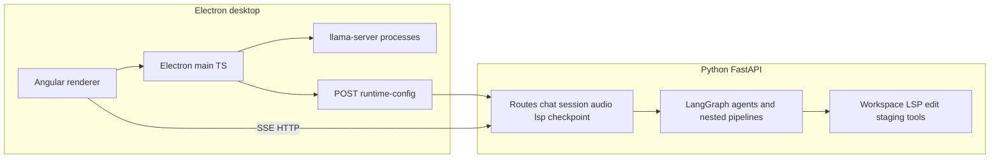
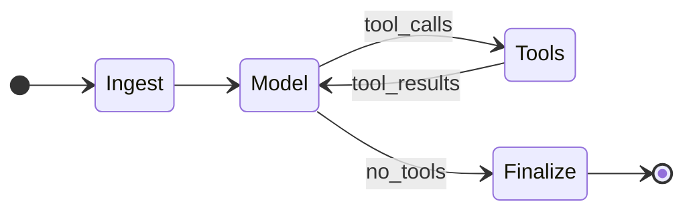

# CLARAV2 — Application analysis and greenfield plan

This document analyzes the **nemo-wrapper** / **Clara AI** codebase (Electron + Angular + Python FastAPI) as it exists today, synthesizes lessons from **git history**, and defines **Clara v2**: a **from-scratch** iteration with **Python** backend, **Tauri + Rust** frontend, **llama.cpp–centric** LLM access (OpenAI-compatible `llama-server` only for the harness), and intentional use of **LangGraph**, **LangChain**, and **LlamaIndex**—with a **new, minimal agent flow** designed for clarity and scale, **not** a port of the current orchestration.

---

## 1. Purpose and scope

Same as the abstract above: v2 is a deliberate **rewrite** of the agent harness and desktop shell while learning from v1’s architecture and pain points.

---

## 2. Current product — what it is

| Layer                  | Technology                                                                                                           | Role                                                                             |
| ---------------------- | -------------------------------------------------------------------------------------------------------------------- | -------------------------------------------------------------------------------- |
| Desktop shell          | **Electron** 41 (`package.json`)                                                                                     | Main process: IPC, window, spawns Python, manages `llama-server` child processes |
| UI                     | **Angular** 21 (`src/renderer/package.json`)                                                                         | Chat, settings, workspace terminal (xterm), visualization                        |
| Backend                | **Python 3** + **FastAPI** + **uvicorn** (`python/nemo_backend/main.py`)                                             | Chat SSE, sessions, runtime config, audio, LSP routes, checkpoints               |
| Agent                  | **LangGraph** + **LangChain** `create_agent`, SQLite checkpointer (`python/requirements.txt`)                        | Streaming tool agent, nested coding flows                                        |
| Embeddings / RAG index | **LlamaIndex** + OpenAI-compatible embedding client (`python/nemo_backend/workspace_index/`)                         | Workspace semantic index under `.nemo/llama_index`                               |
| Local LLM              | `**llama-server`** (llama.cpp) spawned from TS (`src/main/llama-server-manager.ts`)                                  | Dynamic ports; chat + optional second process for embeddings                     |
| Other LLM APIs         | **OpenAI** + **LM Studio** (OpenAI-compatible URLs) (`src/shared/types/app-config.ts`, `python/nemo_backend/llm.py`) | Configurable providers alongside `llamacpp`                                      |
| Terminal               | **node-pty**                                                                                                         | PTY in Electron main                                                             |

Product naming: renderer `package.json` sets `productName: "Clara AI"`; Python README titles the service “Nemo LangChain Backend.”

---

## 3. Build and run (today)

**Root**

- `npm run build` — `tsc` for main/preload + `ng build` in renderer.
- `npm run dev` — concurrent Angular dev server, `tsc --watch`, Electron (electronmon) pointed at `DEV_SERVER_URL`.
- `npm run setup:python` — `pip install -r python/requirements.txt`.
- `npm run check:python-deps` — dev requirements + deptry.

**Python** (`python/README.md`)

- venv under `python/.venv`; run `python server.py` or `uvicorn nemo_backend.main:app --host 127.0.0.1 --port 5123`.
- Desktop expects **127.0.0.1:5123** by default.

**Coupling**

- Electron **syncs** flattened LLM connections + host hints to Python via `POST /runtime-config` (`src/main/python/workspace-sync.ts`).
- Managed `llamacpp` **base URLs are injected at runtime** (not stored as fixed ports in config).

---

## 4. Dependency snapshot (high signal)

**Python** (`python/requirements.txt`)

- Web: `fastapi`, `uvicorn`, `pydantic`
- LLM stack: `langchain`, `langchain-core`, `langgraph`, `langgraph-checkpoint-sqlite`, `langchain-openai`, `openai` (OpenAI-compatible client)
- Data: `aiosqlite`
- Indexing: `llama-index-core`, `llama-index-embeddings-openai`
- Workspace / IDE: `jedi-language-server`, `diff-match-patch`, `pypdf`
- Speech: `edge-tts`, `SpeechRecognition`

**Node / desktop**

- `electron`, `electron-rebuild` (native `node-pty`), `typescript`, `concurrently`, `wait-on`, `cross-env`
- Renderer: Angular 21, Bootstrap, Chart.js, Three.js, Marked, xterm, Vitest

There is **no Rust / Cargo.toml** in v1; v2 adds a new stack under `clara-v2/`.

---

## 5. Backend architecture (conceptual)

**Routers mounted** in `python/nemo_backend/main.py`: runtime, session, chat, audio, LSP, logs, checkpoint.

**Chat path:** `python/nemo_backend/routes_chat.py` → `python/nemo_backend/agent.py` `stream_agent_reply` → LangGraph streaming → **SSE** (`status`, `chunk`, `[DONE]`).

**Configuration surface:** Large set of env-tuned limits and feature flags in `python/nemo_backend/config.py` (outer phased graph, coding planner, discovery limits, embeddings chunking, edit diff limits, etc.).

---

## 6. Agent flow today (why v2 should not copy it)

The codebase evolved into a **multi-layer** system:

1. **Outer “phased” LangGraph** — Learn → Write → Verify with optional retry (`python/nemo_backend/outer_coding_cycle_graph.py`): separate `create_agent` subgraphs, filtered tool sets, middleware per phase.
2. **Coding planner** — Optional graph between “Clara” and router/specialists (`python/nemo_backend/config.py` `NEMO_CODING_PLANNER_ENABLED`, probe/fast-path flags).
3. **Nested pipelines** — `plan_and_modify`, `execute_workspace_mutation`, router + specialists (`python/README.md`).
4. **Human-in-the-loop** — Stream pauses; `python/nemo_backend/routes_chat.py` `POST /chat/agent-continue` branches for delete/copy/accept-command/staged transfer.
5. **Many middlewares** — Diff/copy/delete/accept reviews, empty-response nudges, parallel tool calls, harness feedback, etc. (imports in outer graph file).

**Properties:** Powerful for complex coding tasks, but **high coupling**, many **environment toggles**, and **several continuation surfaces** (checkpoints + HITL). This is the main **roadblock to “simple first”**: new contributors and new features pay a **complexity tax** before the core harness is stable.

---

## 7. Git history — narrative (from `git log --oneline`)

Recent history (newest first) shows recurring themes:

- **15df7fc** — MoE/Gemma tuning, workspace index, LSP, agent UI (large integration PR).
- **bf04a70** — Checkpoint milestone.
- **d916c83** — Orchestration, streaming, nested pipeline, virtual scroll, shared stream payload.
- **f58b281** — Python LSP, test venv bootstrap, accept-command review middleware, README/requirements.
- **569ac3f / 5209798 / bffe72e / 05c215c** — Coding planner, staging tools, interrupt, LangGraph rebuild, edit tools/settings.

**Lesson:** The project **iteratively stacked** planner → nested agents → LSP → index → UI polish. A v2 should **invert** that: **one thin vertical slice** (chat + one tool + stream + abort), then add planner/LSP/index as **optional modules** behind stable interfaces.

---

## 8. Roadblocks and risks (honest assessment)

1. **Agent orchestration complexity** — Hard to reason about end-to-end behavior; tests must cover many interaction orders.
2. **Split brain: Electron vs Python** — Runtime config, session sync, and managed ports are correct but **easy to desync** when adding features (two languages, two deployment surfaces).
3. **Provider matrix** — Three LLM provider kinds + per-model managed commands increase **test and UX** surface (`src/shared/types/app-config.ts`).
4. **Angular + Electron weight** — Large bundle, separate dev servers, native rebuild for `node-pty`; **Tauri** can shrink distribution and unify native logic in Rust (with tradeoffs for PTY/terminal).
5. **Embeddings vs llama.cpp** — Second `llama-server` or separate base URL; chunking/token limits (`python/nemo_backend/config.py`) — operational sharp edges.
6. **HITL + streaming** — Correctness depends on session state and pause events; easy to get **stuck streams** if UI/backend disagree.
7. **LangChain/LangGraph churn** — Pin versions (`python/requirements.txt`); v2 should **isolate** vendor types behind internal DTOs.

---

## 9. Clara v2 — goals (non-negotiables)

1. **Backend:** Python (keep FastAPI or equivalent async ASGI).
2. **Desktop:** **Tauri 2** (Rust) — WebView UI (see §10 for UI choice).
3. **LLM harness:** **llama.cpp only** for *inference* — i.e. **OpenAI-compatible HTTP** to `llama-server` (and optional second server for embeddings). **Remove** (or strictly defer) first-class OpenAI/LM Studio *chat* provider rows unless you later add them as explicit non-goals for “harness simplicity.”
4. **Libraries:** Use **LangGraph** as the primary composition layer; **LangChain** for models/tools where practical; **LlamaIndex** for indexing/RAG when needed—not for every chat turn.
5. **Agent flow:** **New design** — start **minimal** (see §11); **do not** port outer phased graph, coding planner, or nested specialist pipeline in v1.

---

## 10. Tauri + Rust frontend — recommended shape

- **Rust:** App lifecycle, **child process management** for `llama-server` (port allocation, health checks, log tailing), **IPC/commands** to the WebView, filesystem permissions, optional **sidecar** spawn for Python backend.
- **WebView UI:** Practical options: **SvelteKit** or **React** (smaller than Angular for a greenfield); keep **one** SPA. Rust owns **security** and **process**; UI owns **layout** and **streaming display**.
- **IPC contract:** Versioned JSON messages (e.g. `clara.ipc.v1`) for config, stream events, abort—mirror the discipline you already have in shared TS types but generate or hand-maintain **Rust structs** + TS types from a small schema if needed.

**PTY / terminal:** Re-evaluate: Tauri can shell out or use plugins; if terminal is essential on day one, scope a **minimal** terminal or defer to phase 2.

**Implemented spike:** See `clara-v2/README.md` — Tauri 2 + vanilla TS frontend, Python backend under `clara-v2/python/`, OpenAPI at `clara-v2/contracts/openapi.yaml`, IPC types in `clara-v2/contracts/ipc-v1.ts` and `clara-v2/src-tauri/src/ipc_v1.rs`.

---

## 11. Agent flow v2 — “simple first, scalable later”

**Principle:** One **explicit** state machine in LangGraph with **few nodes** and **narrow tool contracts**. Add subgraphs only when the **outer** API is stable.

**Phase A — “Harness MVP” (weeks-scale, not feature parity)**

- **Nodes:** `ingest_user` → `model` → `tools` (optional loop) → `finalize`.
- **Tools:** Start with **read-only** workspace tools (list, read file slice, grep) + **one** edit path (e.g. unified patch or single “apply edit” with server-side validation)—**no** nested agent inside a tool.
- **Streaming:** Single SSE or WebSocket channel; **abort** as cancel scope / task kill.
- **Persistence:** In-memory or single SQLite thread id; **defer** full HITL until streaming is bulletproof.
- **LLM:** Single `ChatOpenAI`-style client pointed at `llama-server` `/v1` only.

**Phase B — “Safe writes”**

- Staging area / preview in **one** place (not parallel middleware chains).
- Optional **LangGraph interrupt** pattern for approval (one codepath).

**Phase C — “Planner / multi-step coding”**

- Add a **subgraph** invoked **only** from a top-level `plan` tool or a dedicated node—never hide an agent inside middleware.
- Consider **LlamaIndex** for retrieval-augmented **planning context** only when index freshness guarantees are defined.

**Phase D — “IDE depth”**

- LSP integration behind a **ToolProvider** interface (same as filesystem tools).

**Scalability mechanisms (design, not day-one code)**

- **Plugin registry:** Tools registered with JSON schema + capability tags (`read`, `write`, `network`).
- **Policy layer:** Which tools exist per mode (`ask`, `agent`, `coding`).
- **Observability:** Structured logs + trace id per session; replay fixtures for regression.

This replaces the current **multi-graph + nested worker + planner probe** model with something you can **draw on one screen** and test exhaustively.

**Implemented MVP:** `clara-v2/python/clara_backend/harness/graph.py` — LangGraph with ingest → model → tools → finalize; read-only tools in `tools_readonly.py`; abort via `POST /chat/abort` and `asyncio.Event` per session.

---

## 12. Backend modules (v2 suggested layout)

Implemented under `clara-v2/python/clara_backend/`:

- `main.py` — FastAPI app and router mounting.
- `routes_chat.py`, `routes_health.py`, `routes_runtime.py` — HTTP API.
- `harness/` — LangGraph graph, streaming run loop, abort integration.
- `llm/` — `build_llm()` factory (OpenAI-compatible → `llama-server` only).
- `tools/` — Read-only workspace tools.
- `session/` — Per-session abort events and workspace root.

Future: `index/` for LlamaIndex when needed.

**LangChain / LangGraph:** Use **checkpointer** only when resume is a product requirement; otherwise SQLite file growth and migration add cost early.

---

## 13. What to reuse vs rewrite

| Asset                                                         | Reuse idea                                                                                      |
| ------------------------------------------------------------- | ----------------------------------------------------------------------------------------------- |
| SSE event shapes / stream parsing concepts                    | Specify v2 contract; optionally keep similar UX                                                 |
| Workspace safety patterns (path traversal, limits)            | Port **ideas**, not every function                                                              |
| Embeddings chunking lessons (`python/nemo_backend/config.py`) | Port constants after measuring v2 tokenizer behavior                                            |
| `llama-server` spawn + port picking                           | **Rewrite in Rust** (clearer than TS for Tauri) — see `clara-v2/src-tauri/src/llama_manager.rs` |
| Angular / Electron IPC                                        | **Replace** with Tauri commands + events                                                        |

---

## 14. Migration strategy

1. **New repository** (recommended) or `clara-v2/` monorepo folder to avoid fighting old imports. **This repo uses `clara-v2/`** as the greenfield tree.
2. **Contract-first:** OpenAPI or typed IPC for chat + config only (`clara-v2/contracts/`).
3. **Python sidecar:** Tauri starts Python (`clara_backend`); health gate before enabling Send.
4. **Feature parity is not the goal** for first release; **reliability and clarity** are.

---

## 15. Open decisions (record in CLARAV2.md and resolve early)

- **Web stack inside Tauri** (Svelte vs React vs keep Angular — unlikely worth dragging Angular for v2). *Spike uses vanilla TypeScript + Vite.*
- **Speech:** Stay Python-only with optional cloud STT, or add **whisper.cpp** later for local-only story.
- **Single vs dual llama-server** for chat+embeddings (dual is flexible; single simplifies ops).

---

## 16. Deliverable checklist for the repo

- Create `CLARAV2.md` at repository root with this full document.
- Spike: `clara-v2/` — Tauri 2, Rust `llama-server` manager (port pick + optional spawn), FastAPI SSE chat + LangGraph harness.
- Contracts: `clara-v2/contracts/openapi.yaml`, `ipc-v1.ts`, `ipc_v1.rs`.
- Phase A agent: read-only tools + `POST /chat/abort`.
- Optionally split “Analysis” vs “v2 Spec” into two files later—only if the team asks.

