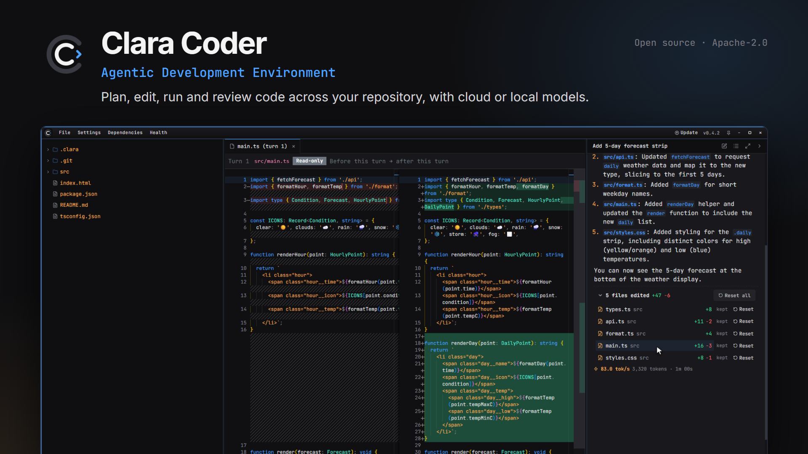
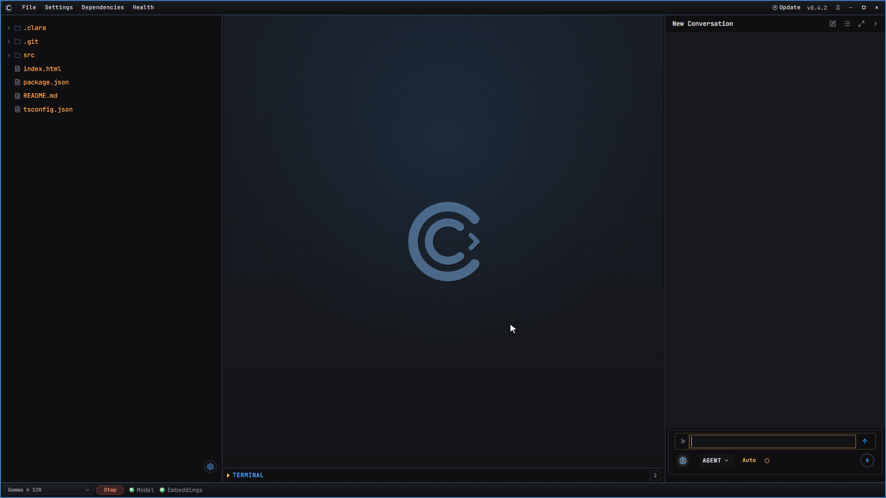
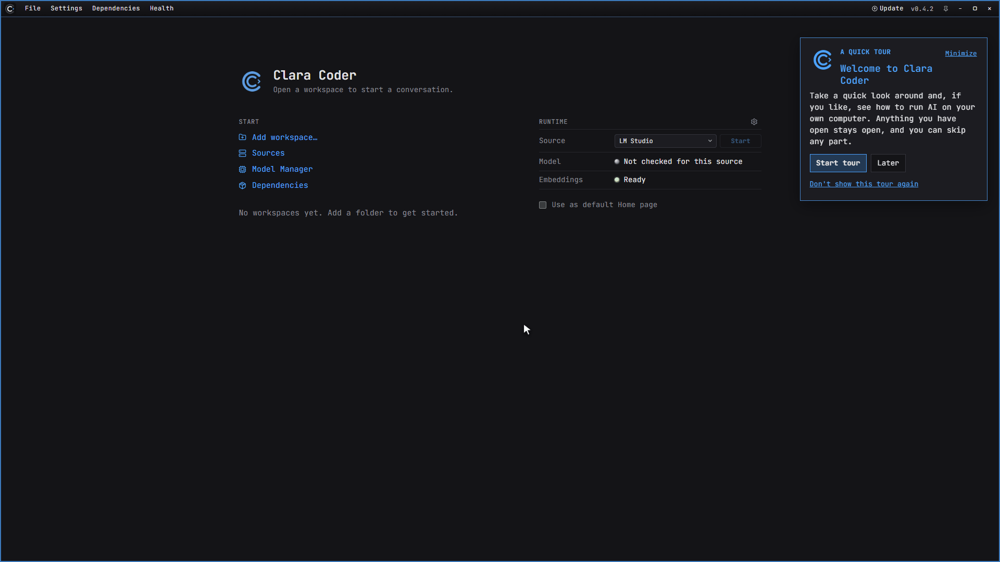
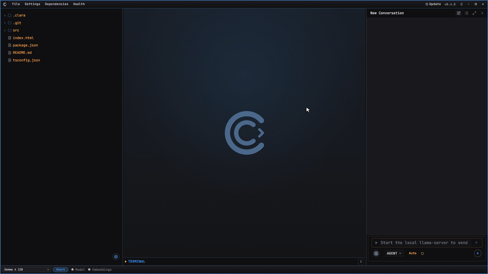
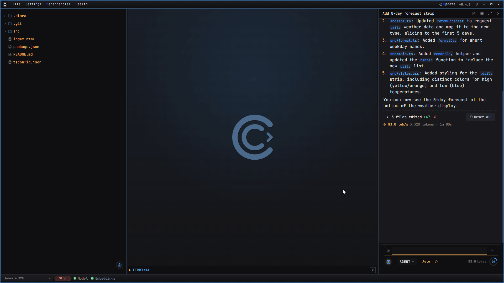
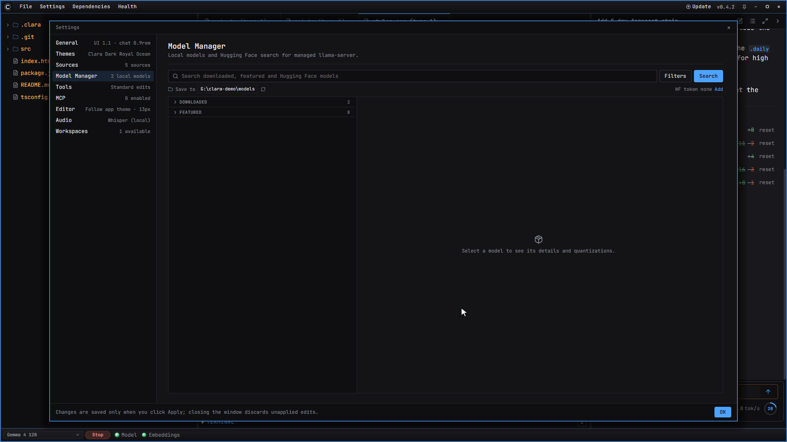

  

  
  

<h3 align="center">An agentic development environment for working in real repositories, with cloud or local models.</h3>

  <a href="https://github.com/dpere122/ClaraCoder/releases/latest"><b>Download for Windows</b></a> ·
  <a href="BUILDING.md">Build from source</a> ·
  <a href="THEMES.md">Themes</a>

  
   Gemma 4 12B running locally on an RTX 5070 Ti. Waits sped up.

---

## New

### Guided tour

First launch walks you through workspaces, sources and running AI on your own machine. Skip any part.

### Built-in updates

Pick a version, download, restart. Each installer is verified before it runs.

---

## Features

### Review and reset

See every edit as a diff. Undo one file or the whole turn.

### Run models locally

Browse Hugging Face, download a GGUF, see how it fits your GPUs.

Or connect **Claude**, **OpenAI**, **OpenRouter**, **LM Studio** or any OpenAI-compatible endpoint.

### Also included

| | |
| - | - |
| **Agent tools** | Edit, search, shell, web, LSP, MCP, sub-agents and build plans |
| **Semantic search** | A local index, so you can search code by intent |
| **Themes** | Full theme engine, or [ask Clara to design one](THEMES.md) |
| **Health** | Live GPU, VRAM, CPU and runtime status |
| **Dependencies** | Local engine, Java LSP and speech, installed on demand |

---

## Install

**Windows:** [download the installer](https://github.com/dpere122/ClaraCoder/releases/latest). Everything is bundled. Add a model under **Sources** and go.

**macOS and Linux:** [build from source](BUILDING.md).

---

[Build from source](BUILDING.md) · [Themes](THEMES.md) · [Press kit](docs/media/README.md) · [Apache-2.0](LICENSE) ([notice](NOTICE))
